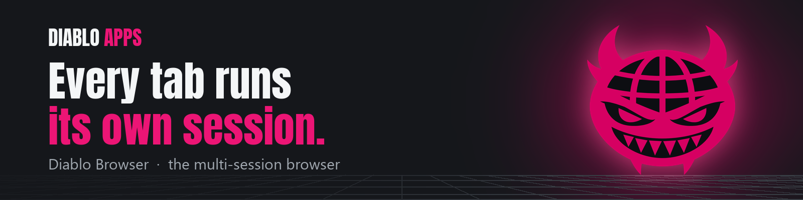

  

We make **Diablo Browser**, a desktop browser for people who run many accounts at once.
Every tab keeps its own logins, proxy and timezone, so one session never leaks into another.

Our code is private. To try Diablo or get help:

- **Website:** [diabloapps.com](https://diabloapps.com)
- **Support:** [support@diabloapps.com](mailto:support@diabloapps.com)
